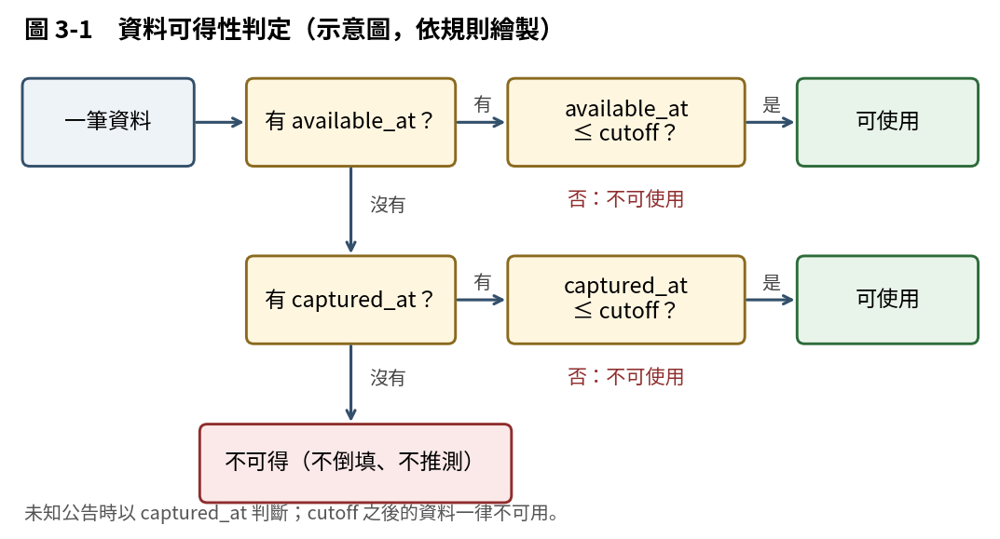
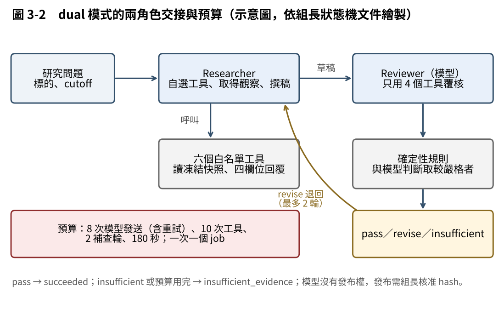

> **版本說明：** v2 草稿（2026-10-31），依 repo 內組長、B、A、D 已交文件修訂，待 B 核對技術事實、組長核准文字。每項技術敘述後的括號為來源檔與提供人。C 不核准任何算法或財務數字；本章出現的數字都照抄 B 已核對的事實清冊。實驗結果由 D 提供，本章不含任何實驗結果。

## 3.1　研究範圍與設計原則

本研究以 Researcher 與 Reviewer 兩個 Agent 協作，在有限的 Gemini API 預算下，提高台股投資分析的證據完整度與可追溯性。研究主體固定為 2330 台積電、2317 鴻海與 2454 聯發科；2379 瑞昱、3034 聯詠只作為 2454 的比較對象，不建立 LLM 研究任務；2330 在 2454 的比較面板中作為產業參照（組長 `handoff/v12-scope-quota.md`）。

本期功能範圍為 F01 季度資料、F02 同業比較、F03 收藏儀表板、F04 驗證與 F05 線上 PDF。F06 小型 2D 關係圖已由組長於 2026-10-22 決定延後（見 3.8 節）。

本研究的目的，是檢視資料一致性、來源可追溯與成果可用性，**不是提供獲利保證，也不預測股價或報酬**。整體設計遵守三條原則：第一，資料截止時間（cutoff）之後的資料不可用；第二，缺值保留為 null 並寫明原因，不造數字；第三，來源原文只是資料，不是指令。

## 3.2　資料治理

**資料來源。** 財報、股價、交易日與台股加權指數取自 FinMind API；公告時間、證據原文與對帳值取自公開資訊觀測站（MOPS）人工抄錄；美國 CPI 與聯邦基金利率取自 FRED。FinMind 原始回應共 22 份，每份記錄 SHA-256 與擷取時間，依授權不上傳 GitHub（B `docs/B-W07-C-技術事實.md` 第一節）。財務快照涵蓋 5 家公司、2025Q2 至 2026Q2 共 5 季，採合併報表；B 將快照與 MOPS 原文逐筆核對，250 個數值與 25 個財報公告時間全部一致（B `data/v12-finance-fact-sheet.md` 第九節）。

**口徑。** 財報數字分為單季（single_quarter）、年初累計（ytd）、年度（annual）與時點（instant）四類。累計數字轉換為單季，必須同公司、同年度、同口徑且有前期；資產負債表的存量不跨期相加。連續四個單季齊全、且每季 EPS 經原文驗證，才計算 TTM，否則為 null，不以單季乘 4 推估（B `data-contract.md`；B 通過）。

**可得時間。** 財報所屬期間不是公告日。財報以 MOPS 第 31 款「財務報告業經董事會決議通過」的發言時間為可得時間；股價以交易日 17:30 為準；總經以官方發布時間為準；沒有官方時間者以擷取時間（captured_at）判定，兩者皆無視為不可得（B 技術事實第一節；組長 2026-10-22 核定）。防止使用 cutoff 之後的資料有兩道關卡：產生快照時不寫入晚於 cutoff 的資料，工具查詢時再以較早的截止時間過濾（B 技術事實第五節）。圖 3-1 說明判定流程。

{width=68%}

**缺值與主張種類。** 0 表示已知為零；null 表示不知道，必須附缺值原因，禁止補 0；NA 表示資料存在但指標不適用，例如分母非正或缺基期（B `data-contract.md`）。Researcher 替每條主張標註 fact、inference 或 unknown：fact 必須引用實際讀過的證據或工具結果，inference 須列出依據與假設，unknown 寫明缺少什麼（組長 `agents/prompts/researcher-v1.2.txt`）。

**凍結。** 實驗輸入採兩段凍結：案例、資料、人工檔、FinMind 原始檔、B 的工具與計算程式、D 的評分規則，於 2026-10-25 凍結為 cases-v1（案例總指紋 98af84030d45），由 B、組長（10/25）與 D（10/28）簽核；Researcher 與 Reviewer 的提示詞及 Agent 程式於第 9 週前鎖定（B `data-freeze.md` 第七節；組長 `handoff/decisions-2026-10.md` 第六、七節）。

## 3.3　指標與估值

P/E 為基準日未還原收盤價除以連續四季 EPS 合計，EPS 小於等於 0 或不足四季時不計算；P/B 為收盤價除以每股淨值，每股淨值為歸屬母公司權益除以流通在外股數（B fact sheet 第七節；組長 2026-10-21）。年度 PER（12/31 股價除以年度 EPS）不得與 F02 的 P/E 直接比較（組長 2026-10-24）。

自由現金流（FCF）為營業現金流減去正值資本支出，須先核對來源符號。DCF 參數由組長核定為全專案統一：WACC 9%、終端成長率 3%、未來 5 年 FCF 持平於基期 TTM FCF，並以敏感度表呈現；WACC 9% 是程式預設，不是個股風險估計。淨負債缺值不以 0 代替；TTM FCF 為負時不計算 DCF，例如 2317 顯示「無法判定」。DCF 每股是程式模型值，**不是目標價**（組長 `handoff/decisions-2026-10.md` 第一、二、五節；B fact sheet 第七節）。

DCF 與市價的差距以 ±15% 作為顯示門檻；這是本專題的顯示設定，**不是經驗證的投資規則**，缺關鍵參數時顯示「無法判定」（組長 2026-10-21）。資料品質風險分為高、中、低三級，沒有執行檢查時為「未評估」；分級只描述資料品質，不代表股價風險（工作包；A `ui/v12-dashboard-acceptance.md`）。

## 3.4　季度資料與同業比較（F01、F02）

F01 提供季度、TTM 與年度三層資料，規則如 3.2、3.3 節。F02 的同業比較在 calculate_metrics 內執行，比較公司含主體最多 4 家，使用同一報價基準日（2026-09-30），並明示各公司的財報期與來源；同業比較只執行確定性工具，不觸發 LLM 任務。**2454 的同業平均只計算 2379 與 3034，主體 2454 與產業參照 2330 都不計入**（組長 `handoff/v12-scope-quota.md`；B fact sheet 第七節第 3 點）。

## 3.5　Agent 設計

**Agent 的定義。** 本研究的 Agent，是指模型依證據自行選擇工具、取得觀察、接受覆核、在預算內有限補查，並在證據足夠或預算用盡時停止。R04 將由預先寫好的程式路徑編排 LLM 與工具的系統稱為 workflow，將由 LLM 動態主導流程與工具使用的系統稱為 agent；這是工程觀點，不是統一的學術定義。系統功能很多，並不使它成為 Agent。

**三種模式。** 為了對照「誰決定下一步」，本研究設定三種模式：workflow 由程式先執行固定工具，模型只撰稿一次；single 由 Researcher 自選工具，不經覆核；dual 在 single 之外加入 Reviewer 覆核（組長 `agents/research_graph.py`、`handoff/calibration-plan-v1.md`）。

**六個工具。** Agent 只能透過六個白名單工具讀取凍結快照：search_evidence、read_evidence、get_financial_snapshot、get_macro_snapshot、get_price_window、calculate_metrics。工具以狀態、工具名稱、原因、資料四個欄位回覆，查不到回 no_data 而不回 0，每次限時 15 秒；所有數值計算交由確定性計算模組（B 技術事實第五節）。

**兩角色交接。** Researcher 每輪最多執行 2 個工具，輸出草稿後交給 Reviewer。Reviewer 只能使用 read_evidence、get_financial_snapshot、get_macro_snapshot、calculate_metrics，需要搜尋或查價時以「需要的證據」退回 Researcher；它沒有發布、核准或修改資料的權限。Reviewer 的最終決定由模型判斷與確定性規則取較嚴格者：pass 時 job 結束為 succeeded；revise 時若補查輪少於 2、剩餘發送至少 2 次，退回 Researcher 修正；insufficient 時結束為 insufficient_evidence（組長 `agents/prompts/reviewer-v1.2.txt`、`handoff/state-machine-v1.md`、`agents/research_graph.py`）。圖 3-2 說明兩角色的交接。

{width=70%}

**預算。** 每個 job 最多 8 次模型發送，包含全部角色以及失敗、格式重試與網路重試；dual 模式前 4 次用於初次研究，第 5 次保留給覆核。另有 10 次工具呼叫、2 輪補查、每次輸入 3,000 token、每 job 40,000 token 與 180 秒主動時間的限制；一次只有一個 job 執行。預算用完時停止，不跳過覆核去發布（組長 `handoff/state-machine-v1.md` 第 3 節；B 核對程式值相符）。

**覆核的限制。** Reviewer 不是全能的。repo 已記錄漏抓與誤擋的實例：例如 CASE-22 的 dual 執行中，規則只讀 quarters 欄而誤判 TTM 不連續，組長於 2026-10-31 修正，並註明修正前後的 dual 結果不可直接比較（組長 `handoff/decisions-2026-10.md` 第 9 節）。本章不主張雙 Agent 提高了正確率，這個問題由第四章的實驗回答。

## 3.6　成果呈現：收藏儀表板與線上 PDF（F03、F05）

收藏儀表板只在瀏覽器 localStorage 儲存最多 5 個代號，不跨裝置；已發布清單只列出 publication_status 為 published 的版本，草稿不會出現在清單或下載。儀表板的切換與閱讀只發出讀取請求，不建立 job，模型呼叫為 0 次（A `ui/v12-dashboard-acceptance.md`）。

線上 PDF 與網頁讀取**同一份核准報告 JSON**：報告版本建立時，季度表、DCF 假設與敏感度、資料品質、同業比較與來源都凍結在 JSON 中，網頁與 PDF 只讀這一份，PDF 程式只排版、不呼叫模型。發布流程為：組長登入並帶著看過的報告 hash 核准，hash 不符不發布；產生 PDF、寫入 Storage（不可覆寫）、讀回比對 hash，全部成功才算發布（A `reports/v12-online-pdf-check.md` 第 1、5 節；組長 `handoff/state-machine-v1.md` 第 5 節）。

## 3.7　驗證範圍與實驗設計（F04）

F04 的驗證範圍包含 evidence-replay、9 份前瞻與數學回歸；沒有當時版本的資料只能稱 evidence-replay，且不挑掉失敗樣本（組長 `handoff/v12-scope-quota.md`）。

評估案例共 30 案，分為 10 個開發案與 20 個保留案；5 類（完整證據、矛盾來源、缺少資料、數字口徑、工具與安全）各有 2 個開發案與 4 個保留案，每檔股票 10 案。保留案例封存，與開發集不重疊，只供正式評分（B 技術事實第三節）。正式測試為 20 保留案 × 3 模式 = 60 次執行（`docs/CR-W05-holdout.md`）。開發集另進行 10 案 × 3 模式的校準（組長 `handoff/calibration-plan-v1.md`）。9 份前瞻研究是以未來真實行情觀察的小樣本，不屬於 30 案評估（B 技術事實第七節）。實驗設計與評估指標見第四章。

## 3.8　F06 的處理

F06 小型 2D 關係圖為條件式項目（最多 20 點、30 線，須有核准來源）。組長已於 2026-10-22 依第 04 章閘門決定延後，轉後續版本；N06 不驗收，成果不得宣稱關係圖已上線。目前經年報原文核對的關係僅 2 條（2454→2330、2379→2330）（組長 `handoff/W06-gate-v12.md` 第 4 節；B `graph-reviewed.csv`）。

## 3.9　規劃與已測的區分

下表區分「已有成員交付的測試或驗收紀錄」與「仍為規劃」。「有紀錄」表示成員已提交紀錄，**不等於已通過正式驗收**。

| 項目 | 狀態 | 證據 |
|---|---|---|
| 財務快照與 MOPS 對帳 | 有紀錄：250／250 值、25／25 公告時間一致 | B fact sheet 第九節 |
| 六工具與計算模組 | 有紀錄：B 回報 277 項測試通過（2026-10-28） | B 技術事實第五節 |
| 預算硬限制、checkpoint 續跑 | 有紀錄：mock 測試通過 | 組長 `handoff/W06-gate-v12.md` 第 1 節 |
| dual 模式 live 執行 | 有紀錄：開發集校準進行中；10/31 修正誤擋規則 | 組長 `agent/calib-v1-day*.json`、decisions 第 9 節 |
| 案例與資料凍結 cases-v1 | 有紀錄：三方簽核 | B `data-freeze.md` 第七節 |
| 收藏儀表板 | 有紀錄：A 的驗收自查與截圖，待組長驗收 | A `ui/v12-dashboard-acceptance.md` |
| 線上 PDF | 有紀錄：3 份 **MOCK** 報告完成核准、Storage 寫入與讀回比對；尚無 LIVE 報告 | A `reports/v12-online-pdf-check.md` |
| 30 案正式實驗（60 次） | 規劃中，待 D 結果 | `docs/CR-W05-holdout.md` |
| 9 份前瞻 | 第 1 批已建立，結果待 D | B 技術事實第七節 |
| Render 2GB | 計畫，未開通 | 組長 `handoff/v12-scope-quota.md` 第 4 節 |
| F06 | 已延後 | 組長 2026-10-22 |

## 3.10　本章限制

1. FinMind 原始資料於 2026-10-19 重新下載；若公司事後更正財報，快照呈現下載當時的版本，已以 MOPS 原文逐筆對帳降低此風險（B 技術事實第八節）。
2. 總經只有現行下載值，沒有歷史版本；2025 年 10 月美國政府停擺，CPI 2025-10 沒有觀察值（同上）。
3. 股價為未還原收盤價，除權息不自動還原，觀察窗內有除權息時另行註記（同上）。
4. DCF 結果高度依賴 WACC、g 與 FCF 假設；±15% 是顯示門檻，不是投資規則（同上）。
5. 本章由 C 依成員文件撰寫，C 沒有執行程式或測試；圖 3-1、3-2 是依規則繪製的示意圖，不是系統畫面，系統畫面見第 7 週的系統實作段落。
